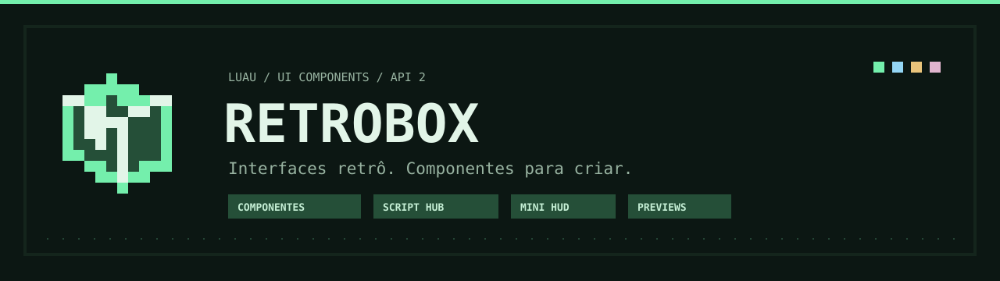

<p align="center"></p>

# RetroBox UI

<p align="center"></p>

[](https://github.com/ManoGustavo02/RetroBox/actions/workflows/validate.yml)

**Retro interfaces. Components for your own project.**

A standalone Luau GUI library for scripts running through compatible Roblox client executors. Windows, themes, controls, live data, compact views and Script Hubs share the same runtime, profiles and resource lifecycle.

[Português](README.md) · [Getting started](RetroBox-UI-v1.1.0/retrobox-ui/README.en.md) · [API](RetroBox-UI-v1.1.0/retrobox-ui/docs/API.md) · [Examples](RetroBox-UI-v1.1.0/retrobox-ui/examples) · [Security](SECURITY.md)

> **RetroBox 2.5.1 · API 2** — distribution maintained by **ManoGustavo02**. Offline visual Designer with typed blocks and Luau export; automatic locales, forms, reusable components, CardGrid and catalog diagnostics. Logic tests do not replace native Roblox rendering checks. [Validation](RetroBox-UI-v1.1.0/retrobox-ui/docs/VALIDATION.md).

## Visual Designer

[**Download the single HTML editor**](https://raw.githubusercontent.com/ManoGustavo02/RetroBox/main/designer/index.html) · [Guide and examples](designer/README.md) · [Native 2.5 APIs](RetroBox-UI-v1.1.0/retrobox-ui/docs/DEVELOPMENT-TOOLS.md)

Save the file as `.html` and open it in your browser. Build interfaces, edit form fields, connect typed blocks, test the preview and export JSON/Luau. It works offline; optional machine translation needs your own service. GitHub displays the source file, so download it to open the actual editor.

## Build with native components

| Need | Components |
| --- | --- |
| Menus and settings | Windows, tabs, sections, controls, search, profiles and shortcuts. |
| Live data | StatCards, charts, tables, virtual lists, logs and dashboards. |
| Compact information | Mini HUD, control pinning and action bars. |
| Previews and operations | Images/models/animations, scoped renderers, tasks, actions, steps and profiling. |
| Game/script catalogs | Native launcher with metadata, thumbnails, favorites, cards and explicit execution. |

Twelve themes and 76 embedded pixel icons. `CreateScriptHub` installs the shared launcher; consumers supply their own catalogs, callbacks and chosen theme. Universal scripts have their own category and badge, with Name, Description and an HTTPS URL or local Callback. See [universal scripts](RetroBox-UI-v1.1.0/retrobox-ui/docs/UNIVERSAL-SCRIPTS.md).

## Purpose and authorized use

The source and examples support learning and developing Luau interfaces, state and resource lifecycles. Use them in experiences you own or environments where you have permission, while following the rules of Roblox, your execution environment and the hosting service.

The documented loader uses HTTP and `loadstring` in a compatible client executor. Consumer callbacks and configured remote code run in that client's environment. Review the source and origin before loading it. Keep credentials and personal information out of distributed scripts.

This notice explains the project's purpose. It does not grant access to third-party services or guarantee hosting approval or protection from suspension. The existing [MIT license](LICENSE) is unchanged.

## Start, contribute and publish

Load the permanent API 2 bootstrap:

```lua
local RetroBox = loadstring(game:HttpGet("https://raw.githubusercontent.com/ManoGustavo02/RetroBox/main/dist/bootstrap/v2.lua"))({Channel="stable", MinVersion="2.5.1"})
```

Read [distribution](RetroBox-UI-v1.1.0/retrobox-ui/docs/AUTO-UPDATE.md) and the [component guide](RetroBox-UI-v1.1.0/retrobox-ui/README.en.md). For a catalog, start with the [native launcher example](RetroBox-UI-v1.1.0/retrobox-ui/examples/native-hub-launcher.lua).

Source remains under `RetroBox-UI-v1.1.0/retrobox-ui/`; `dist/` contains the permanent bootstrap, channel manifests and immutable releases. The new root documentation does not move those files or alter the public API.

[Contributing](CONTRIBUTING.md) · [Support](SUPPORT.md) · [Publishing](docs/PUBLICATION.md) · [Validation](RetroBox-UI-v1.1.0/retrobox-ui/docs/VALIDATION.md) · [Changelog](RetroBox-UI-v1.1.0/retrobox-ui/CHANGELOG.md)

The included workflow runs repository checks and logic/distribution tests on pushes and pull requests when GitHub Actions is enabled. It requests read-only permissions and does not deploy code.

*The banner is vector branding artwork, not a Roblox screenshot.*
