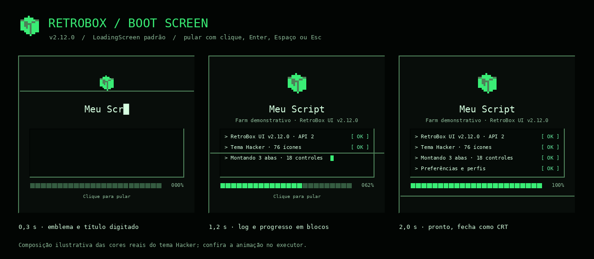

# Tela de boot · RetroBox 2.12 / API 2

Ao executar um script, a janela abre com uma sequência curta de inicialização no estilo terminal retrô. Ela é só apresentação: o script continua criando abas, controles e tarefas normalmente enquanto a animação toca.



[Exemplo](../examples/boot-screen.lua) · [Release](RELEASE-2.12.md) · [API](API.md)

## Sequência

1. O emblema pixel da janela (o `Icon` dela, ou `retrobox`) cresce até o tamanho final.
2. O título é digitado letra a letra; o subtítulo aparece em seguida.
3. O log mostra cada etapa com `>` e recebe `[ OK ]`. Por padrão: versão da library, tema e ícones, quantidade de abas e controles do script, preferências e perfis.
4. A barra de 24 blocos e o percentual acompanham as etapas. Um cursor pisca e uma linha de varredura CRT percorre a tela.
5. No fim, o conteúdo some e a tela se fecha como um monitor CRT (linha → ponto). A janela aparece com a linha de abertura e a entrada dos textos da aba.

Duração padrão: **2 segundos**. Clique na tela, **Enter**, **Espaço** ou **Esc** pulam a sequência. Ocultar a janela durante o boot o encerra; ele não se repete ao mostrar a janela de novo.

## Opções

```lua
local window = Library:CreateWindow({
    Title = "Meu Script",
    LoadingScreen = {
        Duration = 2.4,                -- .6–8 segundos
        Title = "Meu Script",          -- padrão: Title da janela
        Subtitle = "Farm demonstrativo", -- padrão: Subtitle ou "RetroBox UI vX"
        Message = "Versão beta",       -- texto extra ao lado de "Clique para pular"
        Steps = {"Conectando", "Lendo preferências", "Pronto"}, -- 1–8 linhas, até 96 bytes
        Skippable = true,              -- false impede pular
        OnComplete = function(skipped) end,
    },
})
```

| Valor | Resultado |
| --- | --- |
| omitido | Boot padrão quando as animações estão ativas; nenhum boot com Reduced Motion. |
| `true` ou tabela | Boot sempre. Com Reduced Motion, versão estática completa por até .8 s. |
| `{Style = "Card"}` | Carregamento anterior (cartão), finalizado no frame seguinte e sem bloquear. |
| `false` | Nenhuma tela de inicialização. |

## API

- `window:ShowBootScreen(options)` reproduz a sequência (mesmas opções, exceto `Style`). Um boot novo substitui o anterior.
- `window:GetBootScreen()` retorna o handle ativo ou `nil`.
- Handle: `Skip()`, `Finish(skipped?)`, `SetProgress(0–1)` (só avança), `Destroy()`, campos `Progress`, `Finishing`, `Destroyed`, `Skipped`.
- `OnComplete(skipped)` roda uma vez, quando o boot termina, é pulado ou substituído; não roda se a janela for destruída antes.

Para carregamentos reais e demorados (download de catálogo, por exemplo), continue usando `window:ShowLoading`, que tem progresso real, `Timeout` e `Finish`. Não use o boot para esconder trabalho lento: ele termina no tempo configurado.

## Limites

- Todos os timers e tweens pertencem ao escopo do boot e são cancelados ao pular, ocultar, substituir ou destruir a janela.
- O boot cobre a janela inteira (`ZIndex` 300) e captura cliques para o “pular”; controles abaixo não recebem o clique.
- Cores vêm do tema atual e acompanham `SetTheme` durante a sequência.
- Os testes usam tempo e tweens simulados; confira o resultado no executor.
