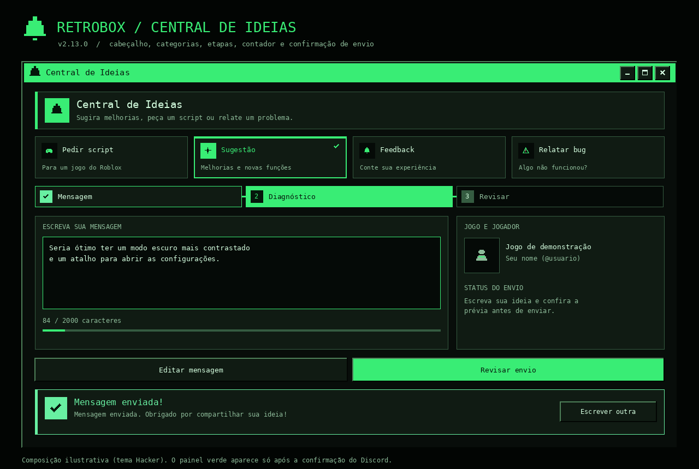
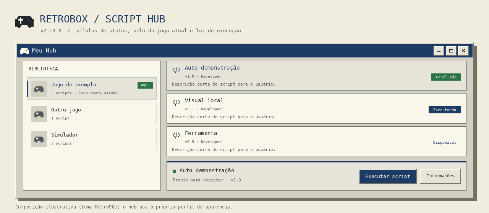

# RetroBox 2.13.0 — Central de Ideias e Script Hub refinados

## Comportamento

A [Central de Ideias](FEEDBACK-HUB.md) ganha uma apresentação de produto: cabeçalho com faixa de destaque e ícone em bloco; cartões de categoria com ícone em bloco, borda de destaque, faixa superior animada e ✓ no selecionado; navegação em etapas numeradas com ✓ nas concluídas, trilho de progresso e botão **Revisar envio** primário; barra de caracteres sob a mensagem; transição suave entre etapas; e um painel de confirmação após a entrega confirmada pelo Discord, com **Escrever outra**.

O [Script Hub](SCRIPT-HUB.md) mostra o status de cada script em pílulas coloridas, marca o jogo desta sessão com **AQUI** e acende uma luz de status no painel de execução.

## Compatibilidade

API 2, bootstrap, IDs dos controles, `GetPage`/`SetPage`, `Layout='Classic'`, transporte, perfis e temas não mudaram. Todas as cores vêm do tema (ou do perfil próprio do hub) e passam pelo ajuste de contraste. Reduced Motion e `Animations` continuam valendo para as transições novas.

## Arquivos

- `src/FeedbackLauncher.lua` (cabeçalho, cartões, etapas, contador, confirmação) e `src/HubLauncher.lua` (pílulas, selo, luz).
- `tests/interface-polish.lua` (5 regressões); `tools/build_docs_images.py` gera `feedback-center.png` e `script-hub.png`.
- Release imutável `dist/releases/2.13.0`, aliases Stable/Preview, Novidades e prompt `docs/Prompt-RetroBox-IA-v2.13.0.md`.

## Verificação

[Validação](VALIDATION.md). Geometria, tweens e transporte são simulados; nenhuma mensagem foi enviada a um Discord real e não há renderer Roblox neste ambiente.
